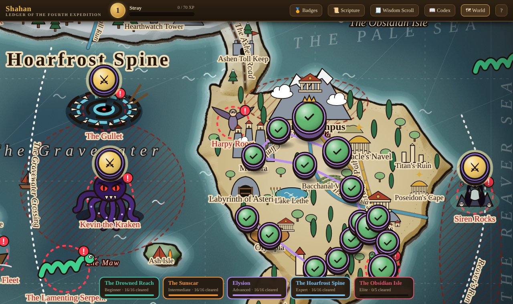
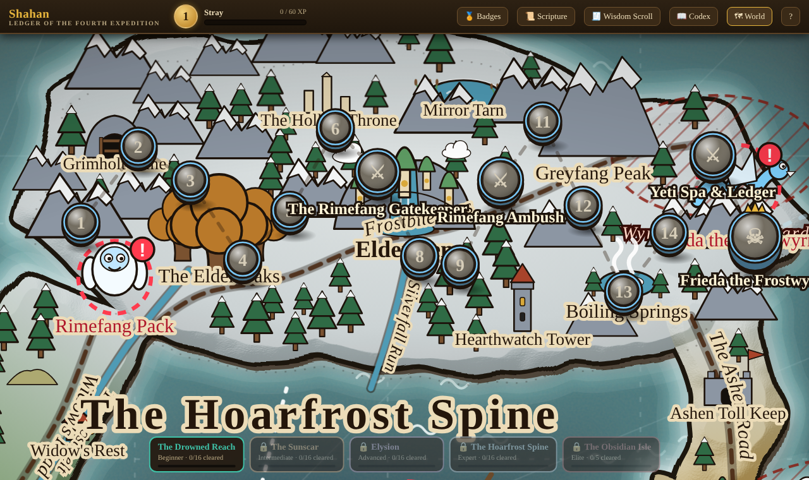

# Shahan: Ledger of the Fourth Expedition

An Excel and VBA learning game on a hand-styled fantasy world map. Every stop on the map is a short lesson or a boss fight, and every challenge is answered by typing a real formula into a working spreadsheet grid. It is a single HTML file, with no server and no install.


**Play it:** open `index.html` in any modern browser. (After enabling GitHub Pages: https://jonapone.github.io/Shahan-An-Excel-Island/)

## What this project shows

- **Excel curriculum design.** 72 stops and 161 rounds, ordered from `SUM` and `IF` to `XLOOKUP`, `SUMPRODUCT`, `LET`, dynamic arrays, text cleaning, and VBA/Office Script reading. See [CURRICULUM.md](CURRICULUM.md).
- **Understanding of how formulas fail.** A third of the rounds are about reading or repairing formulas: predict the output, debug a broken formula (drifting references, unsorted `VLOOKUP`, text stored as numbers, `IFERROR` in the wrong place), or find the buggy line in a macro.
- **AI-assisted engineering with verification.** The game was built in collaboration with Claude. I specified the curriculum and the rules, then play-tested it and sent back every ambiguous puzzle, leaked answer and wrong target range I found. The answer-checking is automated, so it does not depend on trusting the AI (see below).

## How the challenges work

| Round type | What you do |
|---|---|
| Write formula | Fill a target range; the answer is checked against a hidden test sheet, not against a string |
| Debug formula | A broken formula is given; fix it so it works for every row |
| Predict result | Type what the cell will display |
| Choose formula | Pick the one formula that works for all inputs |
| Predict VBA / Office Script | Trace the code and type the output |
| Find the bug | Click the faulty line |

Formulas are graded by **evaluating them**, so any correct formula passes. Hard-coding the answer does not: inputs are varied and the formula must still produce the right result. The engine is a custom spreadsheet evaluator written in JavaScript, with about 95 functions.

## Structure

```
- `index.html` is the built game.
- `engine1.js`, `engine2.js`, `engine3.js` are the spreadsheet engine: parser, evaluator and function library.
- `c1.js` to `c9.js` hold the lesson and boss content, grouped by region.
- `g1.js` to `g4.js` hold the game logic, challenge UI, map overlay and save/restore.
- `mapjs.js` draws the SVG world map, terrain and monsters.
- `wisdom.html` is the in-game Excel cheat sheet.
- `chk.js` is the validator (see below).
- `CURRICULUM.md` lists every stop and its round types.

## Verifying the content

`node src/chk.js` evaluates the reference answer of every formula round against its test sheet and checks that each broken starting formula really fails. The last run was 161 rounds with 0 failures.

## Screenshots

| | |
|---|---|
|  |  |
|  |  |

## Honest limits

- The spreadsheet engine implements a large subset of Excel, not all of it. Behaviour on edge cases (locale, rounding, some array functions) can differ from real Excel.
- Progress is saved in the browser's local storage; there is an export/import code in the in-game help.
- The code was largely written by an AI model under my direction. The curriculum choices, playtesting and corrections are mine.

## Author

Jonathan Ponette 
github: jonapone
Linkedin: www.linkedin.com/in/jonathan-ponette-9914bb70
